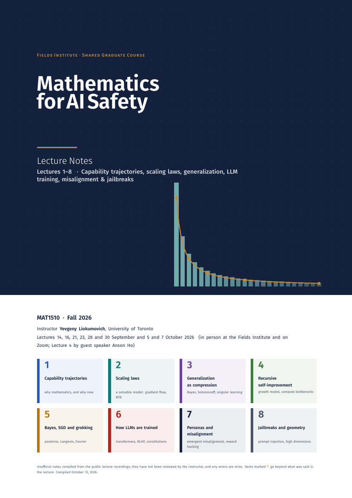

# Mathematics for AI Safety — unofficial lecture notes (MAT1510, Fall 2026)

Polished English lecture notes (LaTeX) for **Mathematics for AI Safety**, the Fields Institute shared graduate course
(U of T code MAT1510, instructor Yevgeny Liokumovich, University of Toronto), written from the public lecture recordings.
This first volume covers **Lectures 1–8** (14 September – 7 October 2026).

**[Download the PDF (222 pages)](MAT1510_Mathematics_for_AI_Safety_Notes_L1-8.pdf)**



Course page: <https://www.fields.utoronto.ca/activities/26-27/SGC-safety>

> **Unofficial.** These notes are not endorsed by the lecturer or the Fields Institute and have not been reviewed by them.
> Please check anything you intend to cite against the recordings and the primary sources.

## What is in the PDF

* **Front matter:** about these notes and a reading guide, the course roadmap with the official 10-week outline, a table of the eight lectures, a short summary of each.
* **Eight chapters**, one per lecture. Each has a lecture map with timestamps, sections that follow the lecture, definitions/theorems/proofs where the lecture gave them, take-aways and exercises.
* **Back matter:** formula sheet, notation, glossary, index of the videos with clickable timestamps, hints and answers, further reading, project ideas, and about 170 references.

| Lecture | Date | Page | Theme | Recording |
|---|---|---|---|---|
| 1 | 14 Sep 2026 | 1 | capability trajectories; why mathematics, and why now | [video](https://www.youtube.com/watch?v=0QIE9tQLV0E) |
| 2 | 16 Sep 2026 | 19 | scaling laws; gradient flow, the NTK and a spectral power law | [video](https://www.youtube.com/watch?v=-XmDvvHqfLI) |
| 3 | 21 Sep 2026 | 32 | generalization as compression: Bayes, Solomonoff, singular learning theory | [video](https://www.youtube.com/watch?v=q_Dj4-QNJV8) |
| 4 | 23 Sep 2026 | 49 | guest lecture (A. Ho, Epoch AI): a software intelligence explosion? growth model, compute bottlenecks | [video](https://www.youtube.com/watch?v=7AaNkZuYfmk) |
| 5 | 28 Sep 2026 | 67 | Bayesian learning, SGD (Langevin) and grokking | [video](https://www.youtube.com/watch?v=xRYdgd_G-j0) |
| 6 | 30 Sep 2026 | 96 | how a large language model is built and trained: architecture, training stages, constitutions | [video](https://www.youtube.com/watch?v=-cqba5tE6aQ) |
| 7 | 5 Oct 2026 | 122 | personas, emergent misalignment, reward hacking; a toy mathematical model | [video](https://www.youtube.com/watch?v=CQ_ECK2lr9g) |
| 8 | 7 Oct 2026 | 154 | jailbreaks, prompt injection; high-dimensional geometry of activation spaces (start) | [video](https://www.youtube.com/watch?v=jKj-pJKit_E) |

(Page numbers are the ones printed in the PDF.)

## Conventions used in the notes

* Margin links `▶ mm:ss` jump to that moment of the recording.
* Boxes: *Definition / Theorem / Proposition / Lemma* (numbered per lecture), *Intuition*, *Caution*, *Open question*,
  *From the discussion* (class Q&A), *Beyond the lecture†* (material added by the note-taker), *Key take-aways*, *Exercise*.
* **†** = added from the literature or by the note-taker; **‡** = a detail recovered from imperfect auto-captions.
* Every figure is drawn in TikZ/pgfplots. Figures marked *schematic* contain no measured data; the others are computed by the scripts in `figures/`.

## Provenance and caveats

* The only source is the recordings. YouTube provides auto-generated captions only (no slides or blackboard). For Lecture 3 the English track was missing, so the text was reconstructed from machine translations cross-checked against each other. The raw captions are not part of this repository.
* The notes were prepared with AI assistance ([Claude Code](https://claude.com/claude-code)): drafting from the captions, re-derivation and numerical checks of the mathematics, independent automated review passes (without web access) on the finished chapters, and web checks of the bibliography of Lectures 5–8. The front matter of the PDF states what was and was not verified; in particular, statements about 2026 events and papers rest on search results and could not be checked independently. The records of the review passes are in `fragments/_review_summary.md` and `fragments/_bibcheck_*.md`.
* Errors surely remain. Corrections are welcome: please open an issue.

## Build

```bash
make            # latexmk -lualatex  ->  main.pdf  and the named copy MAT1510_Mathematics_for_AI_Safety_Notes_L1-8.pdf
make data       # regenerate figures/data/*.dat  (python3 + numpy + scipy; see the scripts in figures/)
make clean
tools/build_chapter.sh N    # standalone build of one lecture chapter (fast)
```

Requires TeX Live with **LuaLaTeX** (fonts: Libertinus Serif/Math, Fira Sans, Fira Mono, all in TeX Live). XeLaTeX will *not* find the fonts by name.

## Layout of the sources

```
main.tex            document skeleton
preamble.tex        design system: fonts, colors, tcolorbox environments, margin timestamps, lecture-map macros
frontmatter.tex     title page, "About these notes", contents, course roadmap (official outline, schedule)
lectures/           lecture01.tex … lecture08.tex (+ continuation files lecture0Nb.tex, lecture0Nc.tex, …)
backmatter.tex      GENERATED by tools/merge_fragments.py from tools/backmatter.base.tex + fragments/L0N.tex
references.tex      GENERATED likewise from tools/references.base.tex, tools/refs_override.tex and the REFS parts of the fragments
fragments/          per-lecture integration pieces of Lectures 5–8 (formula sheet, notation, glossary, video index, hints, reading, projects, references) and the review records
figures/            gen_data.py, grokking.py (PyTorch), gen_data_L5…L8.py, check_L4_bottleneck.py; data/*.dat
tools/              build_chapter.sh, check_log.py, pages.sh, mkbib.py, merge_fragments.py, base files for the generated files
assets/             cover image used in this README
```

`backmatter.tex` and `references.tex` are generated: edit the base files or the fragments and re-run `python3 -I tools/merge_fragments.py`.
